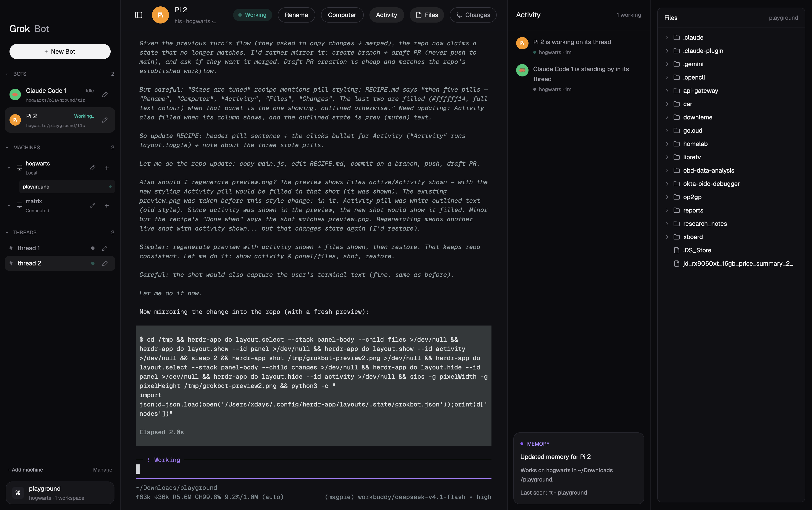

# Grok Bot

A whole window that pretends your coding agents are teammates you message: the sidebar is a
buddy list of "Bots", the middle is the focused Bot's terminal as if it were a chat thread with a
header card on top, and on the right an Activity feed of what the Bots have been up to, beside
Herdr's Files/Changes browser in a second sidebar of its own. Dark, soft, purple-accented, no
system title bar — the window looks like a chat app, not a terminal emulator.

## What you see

Four columns on `#0b0b0e` (the sidebar, Activity and the Files sidebar) and `#101014` (the
thread), separated by 1px `#1f1f25` dividers. The window draws its own chrome: root has
`"titlebar": "none"` and macOS draws its three window buttons over the sidebar at `[18, 20]`.

1. **Sidebar, 268px** (min 200, max 420, draggable), `#0b0b0e`, all text Geist:
   * A 44px empty strip at the top — room for the macOS window buttons.
   * The wordmark: "Grok" 20px bold `#f4f4f5`, then "Bot" 20px regular `#a1a1aa`, 20px from
     the left edge.
   * A full-width white pill "+ New Bot": 32px tall, fully rounded, 13px semibold, dark text
     `#0b0b0e`.
   * A scrolling list of three folded sections. Each section header is 11px semibold `#71717a`,
     with a small `▾`/`▸` twisty, the label (BOTS, MACHINES, THREADS) and a count on the right
     ("3 waiting" in the BOTS header when any Bot is blocked, else the Bot count).
     * **BOTS** — one row per agent: a 24px round avatar in one of eight Bot colors with the
       Bot's initial (or the program's icon), its name 13px semibold, then a short status word
       on the same line (10px, in the status color), and under it a 9px dim address
       `machine/workspace/t1j` in Geist Mono, middle-ellipsised, tooltip with the full ids. A
       pencil button on the right renames. The focused Bot's row is lit (`#ffffff12`).
     * **MACHINES** — one row per machine (this computer plus each connected one): a twisty, a
       small monitor glyph, the machine's display name 12px semibold, and under it "Local" /
       "Connected" / "Connecting…" / "Unavailable" (orange when unavailable) in 10px dim. On the
       right a pencil (rename) and a "+" (New Bot on that machine). Expanded, it lists that
       machine's workspaces, indented 40px, 28px rows, 11px text, the active one filled
       `#ffffff0c` with a 5px status dot.
     * **THREADS** — the shown workspace's tabs: `#` in dim, the tab name 13px (unnamed ones read
       "thread 2"), a 7px status dot, a pencil. 32px rows, the active one filled `#ffffff12`.
   * A footer row of two 11px links: "+ Add machine" and "Manage".
   * A pinned workspace card at the bottom: 48px tall, `#16161a`, 1px `#24242b`, 14px radius, a
     26px "⌘" tile, the workspace name 13px semibold and "hogwarts · 2 workspaces" 11px dim
     under it.
2. **The thread, the rest of the width.** No resize handle to the sidebar, 14px gutter.
   * **Header card, 64px**, `#101014`, 1px bottom border `#24242b`: a 32px sidebar-toggle button,
     the current Bot's 36px avatar, its name 15px semibold, and under it 12px dim
     `t1j · hogwarts · ~/Workspace/app · main`. On the right: a status chip (26px, fully rounded,
     12px semibold, tinted with the status color at 13% `22` alpha, with a 7px dot), then five
     pills in two groups. "Rename" and "Computer" are plain actions: white text on a 1px
     `#34343c` outline. "Activity", "Files" and "Changes" are the three side-column buttons, one
     look and one rule between them: grey text `#a1a1aa` on the same outline while their column is
     away, filled `#ffffff14` with white text while it is on screen — "Activity" for the Activity
     column, "Files" / "Changes" for the panel the right sidebar is showing.
   * **The conversation:** the active tab's terminals as cards, 10px gaps, 14px radius, 1px
     `#24242b` border that turns `#3a3a44` when focused, on `#101014`. Terminals use Geist Mono
     13px with 18/14 padding. A one-pane tab is framed too (`lone: false`).
   * **The composer** — a 96px block at the bottom that ships **hidden** (`"hidden": true`); see
     How it behaves.
3. **Activity, 300px** (min 240, max 480, draggable; can be hidden with the header's Activity
   pill), `#0b0b0e`:
   * A 64px header: "Activity" 15px semibold, and " N working" 12px dim on the right.
   * The feed: one row per status change, 18px padding, 26px avatar, a sentence 13px `#a1a1aa`
     ("Pi is working on Pi", "Pi needs your approval in ops", "Pi finished", "Pi is standing by
     in ops") and under it a 6px dot with "hogwarts · 3m".
   * Pinned at the bottom, a memory card: `#16161a`, 14px radius, a purple dot with "MEMORY" in
     11px semibold `#a78bfa`, "Updated memory for Pi" 13px white, then "Works on hogwarts in
     ~/Workspace/app on main." and a last line "Last seen: …" (or "Runs Pi.") in 12px `#a1a1aa`.
4. **Files / Changes sidebar, 340px** (min 260, max 720, draggable, shown by default),
   `#0b0b0e`, 16px above and below one card, 14px gutters either side. No layout-drawn tab strip:
   the header's Files and Changes pills choose what is in it.
   * **Files** (the default) — Herdr's own file browser as a card: `#101014` at 10px radius with
     a 1px `#24242b` border, a "Files" 13px semibold title with the folder on the right
     ("playground"), then the lazy tree of the focused pane's folder: twisty, folder/file glyph,
     name, folders first, `.git` left out.
   * **Changes** — Herdr's git panel in the same slot: "Changes" with an "N files" chip and
     "+N −N" on the right, the changed files (or "Not a git repository"), a diff viewer, and a
     "Commit message" box with a Commit button along the bottom.

Colors (from the layout's `colors`, matched by the mod's own constants): background `#101014`,
ink/canvas `#0b0b0e`, card/surface `#16161a`, raised `#1f1f25`, border/line `#24242b`, edge
`#34343c`, text `#f4f4f5`, muted `#a1a1aa`, dim `#71717a`, accent `#885cf5`, working `#54b9a6`,
blocked `#f19d38`, done `#3c82f6`. Bot palette: `#ED712E`, `#EB4699`, `#885CF5`, `#54B9A6`,
`#3C82F6`, `#5BC67A`, `#F19D38`, `#EA4045`.

## How it behaves

**Statuses.** Each agent's status colors its dot, its word and the header chip:

* `working` — teal `#54b9a6`. The 8px dot pulses (`loop` opacity 0.35 → 1, 1200ms, native), and
  in the sidebar row the word cycles "Working", "Working.", "Working..", "Working..." every 420ms
  using `.frames` (no timer). Chip reads "Working"; feed line "… is working on <thread>".
* `blocked` — orange `#f19d38`, steady. Word and chip read "Needs you"; feed "… needs your
  approval in <thread>"; the BOTS header count turns into "N waiting".
* `done` — blue `#3c82f6`, steady. Word and chip read "Done"; feed "… finished" (no thread name).
* `idle` — grey `#71717a`, steady. Word and chip read "Idle"; feed "… is standing by in <thread>".

**Clicks.**

* A Bot row focuses it: `run("agent.focus", { terminal: address })`, and if that terminal has a
  pane also `run("pane.focus", { terminal: address })`, so its space/tab and terminal come up.
* A thread row selects the tab: `run("tab.select", { id: tab.id })`.
* A workspace row under a machine selects it: `run("space.select", { id })`. Clicking the machine
  row itself goes to that machine's active (else first) workspace, or opens New Bot on it when it
  has none.
* "+ New Bot" — if there is only one workspace it opens the launcher straight away; with two or
  more it first opens a "which workspace?" picker.
* "+" on a machine opens the launcher for that machine; the pencil next to a machine opens the
  rename dialog; the pencil on a Bot or a thread opens Herdr's `prompt` dialog titled "Rename
  agent and tab" running `tab.rename`.
* Twisty and section header toggle that section; the open/closed shape is kept in shared state,
  so it survives a restart.
* "+ Add machine" runs `mod.open { name: "machine-add" }`; "Manage" runs
  `app.settings { section: "machines" }`.
* The bottom workspace card opens Herdr's `picker` (popup at top, 640 wide, 0.8 of the height).
* Header: the toggle runs `layout.toggle { id: "sidebar" }`, "Computer" runs
  `pane.split { direction: "right" }`, "Rename" renames the current Bot's tab, the status chip is
  not clickable. "Activity" runs `layout.toggle { id: "activity" }`.
* "Files" and "Changes" show the right sidebar on that panel — `layout.select { stack:
  "panel-body", child: "files" | "changes" }` then `layout.show { id: "panel" }` — and a pill
  that is already filled hides the sidebar with `layout.hide { id: "panel" }`. Same rule as
  Herdr's own tab-bar buttons: the filled one is the one showing, clicking it puts the sidebar
  away. The two panels keep their state while hidden (the `files` tree keeps its open folders).
* Feed rows focus that Bot (`agent.focus`).

**The New Bot flow** (two overlay popups, both `mod: "grokbot"`):

* `role: "pick-space"`, 320 × 460 — the machines and their workspaces, numbered 1–9; a digit key
  jumps straight to that workspace, `Esc` closes, "New workspace…" goes to the launcher with no
  space.
* `role: "new"`, 300 × 460 — machine glyph, machine name, workspace name; "Terminal" starts a
  shell (`⌘T`); **START A BOT** lists `knownAgents()` (installed ones first, up to two
  not-installed ones greyed with "not installed"), each on `⌘1`…`⌘9`; "New workspace" (`⌘N`);
  "New worktree…" / "Open worktree…" open Herdr's `worktree` mod dialog for that space. An
  unavailable machine or a vanished workspace shows an orange line instead of acting.
  Launching closes the overlay and then runs either `tab.new { space, argv?, name? }` (existing
  workspace) or `space.new { machine?, argv?, tab? }` (new workspace).
* `role: "rename-machine"`, a 420px dialog: an input prefilled with the current display name
  (selected, so typing replaces it), "Cancel" and a solid "Save" pill that writes shared key
  `grokbot.machine-name."<machine>"` (empty string restores the default name). Renaming a machine
  never touches the real connection name.

**Hovers.** Bot, thread, workspace, machine, feed and footer rows lighten to `#ffffff0a`;
buttons to `#1f1f25`; the pencil and toggle icons go from `#71717a` to `#f4f4f5`; outlined pills
get a 5% white wash; the send button goes white when there is text. Buttons carry tooltips
("Rename agent and tab", "Hide sidebar", "New workspace on matrix", …).

**What moves.** Only native animation: the working dot's opacity loop and the cycling "Working…"
word. A 30s timer in the Activity copy re-renders so "3m" stays honest; nothing else polls.

**The composer**, once shown: a 26px-radius bar with a "+" button (does nothing), an input
placeholder "Message your Bot…", a round ↑ button that turns white while there is text, and an
11px caption "Messages go to <Bot> · it comes back when your approval is needed". Enter or ↑
sends the text into the focused Bot's terminal with `hc(["send", address, text])`.

## Built from

**One layout, one mod.** `layouts/grokbot.json` plus `mods/grokbot/` (no `keys.json` — it needs
none; the app-wide `cmd-1..9` tab keys stay as they are). The layout also points its settings
picture at `layouts/grokbot.svg`, a 320×200 flat drawing of the window in the same colors.

* `layouts/grokbot.json` — root is a `row`, `"titlebar": "none"`, `traffic_lights: [18, 20]`,
  `"preview": "layouts/grokbot.svg"`, theme `graphite`, `ui_font` "Geist", `font` "Geist Mono",
  `font_size` 13, `terminal_padding` `[18, 14]`, the `colors` map above, `background` `#0b0b0e`
  and a 1px `#1f1f25` divider. Children:
  1. `sidebar` — `block`, `size {px: 268}`, `min` 200, `max` 420, `window_drag: true`,
     `background #0b0b0e`, `content {mod: "grokbot", props: {role: "sidebar"}}`.
  2. `thread` — `column`, `resizable: false`, `background #101014`, children:
     `thread-head` (`block`, 64px, `window_drag: true`, props `{role: "header"}`),
     `conversation` (`block`, `padding [0, 14]`, `content {tab: "active", pane: {gap: 10,
     radius: 14, background: "#101014", lone: false, border {width 1, color "#24242b"},
     focus {width 1, color "#3a3a44"}}}`),
     `composer` (`block`, 96px, props `{role: "composer"}`, `"hidden": true`).
  3. `activity` — `block`, 300px, `min` 240, `max` 480, `window_drag: true`, `background
     #0b0b0e`, props `{role: "activity"}`.
  4. `panel` — `column`, `"hidden": false`, 340px, `min` 260, `max` 720, `padding [16, 14]`,
     `background #0b0b0e`, the last column. Its only child is `panel-body`, a `stack` with
     `active: "files"` over two blocks: `files` (`{mod: "files"}`) and `changes`
     (`{mod: "changes"}`) — Herdr's shipped mods, used as they are.
* `mods/grokbot/main.js` (~850 lines) — a `View` whose `render()` switches on `props().role`:
  `sidebar`, `header`, `activity`, `composer`, plus the three overlays `pick-space`, `new` and
  `rename-machine`. `mod.json` is `{"place": "none"}` so the mod never docks itself; only the
  layout places it. The three side-column buttons come from one helper, `togglePill(id, label,
  on, onClick, icon)`: outlined and grey when `on` is false, filled and white when it is true, with
  a "Show …" / "Hide …" tooltip. `activityPill()` passes `on` = the `activity` node is not hidden and
  runs `layout.toggle`; `panelPill(id, label, icon)` passes `on` = the `panel` node is shown *and*
  the `panel-body` stack is on that child, read from `layout()?.children`, and runs the
  hide/select/show commands above.
* `mods/grokbot/machine-model.js` — `machineGroups(machines, spaces, agents)` (drops `temporary`
  machines, always includes this computer, sorts this one first then by name, and gives each
  machine its spaces and agents plus `layout: "ready" | "loading" | "unavailable"`),
  `machineName`, `machineStatus`, and `launchCommand(target, spaces, machines, options)` which
  returns `{name, args}` for `tab.new` or `space.new` and throws a message when the machine is
  not ready or the workspace is gone.
* `mods/grokbot/machine.svg`, `rename.svg`, `sidebar.svg` — 24px stroke icons drawn with
  `stroke="currentColor"`, so they tint with the text color.
* `herdr` functions used: `agents`, `spaces`, `panes`, `machines`, `focused`, `layout`,
  `window`, `settings`, `props`, `shared`/`setShared`, `run`, `openOverlay`/`closeOverlay`, `hc`,
  `home`, `knownAgents`, `setAgentOrder`.
* Commands run: `agent.focus`, `pane.focus`, `tab.select`, `tab.rename`, `space.select`,
  `space.new`, `tab.new`, `pane.split`, `layout.toggle`, `layout.select`, `layout.show`,
  `layout.hide`, `mod.open`, `app.settings`, and overlays of the shipped mods `picker`,
  `prompt`, `worktree`, `machine-add`. The sidebar itself is two shipped mods (`files`,
  `changes`), so the layout needs no code for it.
* Shared keys: `grokbot.folded` (open/closed sections — written only on click) and
  `grokbot.machine-name."<name>"` (display names for machines).
* `gpui-base` for `h_flex`, `v_flex`, `InputState`, `Input`; `gpui-kit` for `div`, `svg`,
  `image`. Avatars use the agent's `program.icon` (tinted `svg` when `program.tint`, else
  `image`) on a colored disc; the color is `PALETTE[hash(address) % 8]` so a Bot keeps its color.

## Watch out

* **Presses inside a `window_drag` block drag the window.** Sidebar, header and Activity are all
  `window_drag: true`, so every clickable inside them must call
  `cx.stop_propagation()` on mouse-down (the mod's `own()` helper) — otherwise clicking a Bot
  moves the window instead of selecting it. Overlays are not affected.
* **The mod ignores `theme()`.** It hardcodes its palette (`C`, `PALETTE`, `STATUS`). That is
  deliberate — it is a look-alike of one product — but it means the theme picker and a light
  theme leave it dark. The layout's `colors` map exists so the terminals and pane frames match.
  A build that uses `theme()` colors will drift from the picture.
* **macOS window buttons sit over the sidebar.** With `titlebar: "none"` the layout must leave
  room: a 44px spacer above the wordmark, `traffic_lights: [18, 20]`, and in the header a left
  padding computed as `max(22, (18 + 64) / zoom - sidebarWidth)` when the sidebar is hidden, so
  the toggle button does not land under the buttons.
* **`pane.focus` needs a pane.** Not every agent has one (sub-agents don't). The sidebar checks
  `panes().some(p => p.terminal === address)` first; a build that calls it blindly throws.
* **Unnamed tabs are called "1", "2"**, which is a poor teammate name, so `nameOf()` turns
  `"1"` into "Pi 1" using the program name. Keep the `tab.named` check or bots appear as digits.
* **The Activity log is per copy and in memory** (`this.log`, capped at 40). It is seeded on the
  first render with each Bot's current status, then appends on any status change (keyed by
  `address + seq + status`). A mod reload or layout switch starts it empty again; it is not
  shared state, on purpose.
* **`⌘1..⌘9` in the New Bot menu rely on the overlay owning the keyboard.** The launcher and the
  workspace picker take a `focus_handle` in `init` and `track_focus` it; the app-wide
  `cmd-1..9` (tab select) still works outside overlays. Skip the focus handle and the menu's
  shortcuts die.
* **Sizes are tuned, not resilient.** Sidebar 268, Activity 300, Files sidebar 340, header 64,
  composer 96. The mod cannot measure its own block, so on a narrow window the Activity column is
  the first thing to fold (it can be hidden) and the Files sidebar the second — the sidebar's
  min 200 keeps the Bot rows readable.
* **The right sidebar reuses Herdr's own node ids:** `panel` for the column, `panel-body` for the
  stack, `files` / `changes` for its children — the same names the shipped tab bar drives with
  `layout.select` / `layout.show` / `layout.hide`. Rename them and the pills act on nothing. The
  pills are only drawn when a `panel` child exists, so the same mod still runs in a layout
  without the sidebar.
* **The `files` and `changes` mods draw their own card** (`#101014`, 10px radius, 1px border), so
  the column adds nothing but `padding [16, 14]` and the `#0b0b0e` behind it. Below about 260px
  the tree's names and glyphs collide; that is what `min` is for.
* **Hex-alpha strings.** Status tints are built as `color + "22"`; they only work because every
  status color is `#rrggbb`. Keep them six digits.
* **Unique element ids.** Every row needs a stable unique `id` (`gb-bot-<address>`,
  `gb-thread-<id>`, `gb-machine-<tag>`); agents can share a tab, so the address (not the name)
  is the id.
* **Display names are shared state, not layout state**, so every layout using this mod shows the
  same names, and a fresh install shows the raw connection name.
* The machine glyph, pencil and sidebar icons must stay in the mod folder and be referenced as
  `mods/grokbot/<file>.svg`.
* Assumes the shipped mods `picker`, `prompt`, `worktree` and `machine-add` exist (they ship with
  Herdr) and that Geist / Geist Mono are available (they ship with Herdr).

## Done when

* `herdr-app check ~/.config/herdr-app/mods/grokbot` exits clean, and after
  `herdr-app do layout.switch --name grokbot` (or the layout picker) `herdr-app status` reports
  no `errors`.
* The window has no system title bar; the four columns fill it, the sidebar is 268px by
  default, the Files sidebar 340px, and the three dividers are visible.
* Every agent in `agents()` appears once under BOTS with a colored initial avatar, a name, a
  status word and a dim `machine/workspace/address` line; clicking one makes its tab the active
  tab and its terminal the focused one — and does **not** move the window.
* Starting a second workspace makes "+ New Bot" open the "which workspace?" popup first; with one
  workspace it opens the launcher directly. `Esc` closes both, `⌘T` in the launcher starts a
  shell in the chosen workspace.
* Renaming a thread (pencil) renames the tab, and the Bot row above changes with it.
* Renaming a machine persists: the new name is still there after quitting and reopening Herdr,
  and an empty name restores the original.
* Folding BOTS, then restarting, finds it still folded.
* An agent going idle → working adds an Activity row within about a second reading
  "… is working on …", its dot pulses, the header chip turns teal and reads "Working", and the
  BOTS count starts reading "N waiting" when any agent is blocked.
* The header's Activity pill hides and shows the Activity column; the sidebar toggle hides the
  sidebar and the header's toggle button then sits clear of the macOS window buttons. The pill
  itself goes grey while the column is away and filled white while it is up — the same two states
  as Files and Changes.
* A 340px Files sidebar sits at the far right, showing the focused pane's folder; the Changes
  pill swaps it for the git panel (and its pill is then the filled one), the Files pill swaps it
  back, and clicking the filled pill hides the whole sidebar without moving the window. The
  files tree still remembers its open folders after a hide/show.
* `herdr-app shot` saves a picture that matches `preview.png`.
